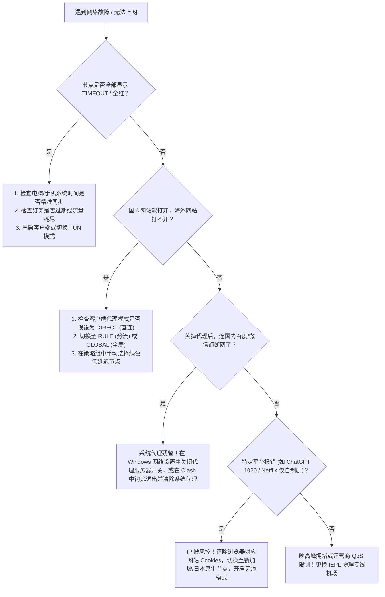

# 2026 机场高频 FAQ 与故障排障全景知识库：节点超时、延迟卡顿与报错排查

> 知识架构：万字级支柱页（Pillar Page） ｜ 核心定位：新手与进阶故障自愈百科 ｜ 数据核实：2026-11-10

在日常使用机场（梯子/网络代理）的过程中，绝大多数用户都会遭遇诸如**“节点全部超时”、“测速正常但打不开网页”、“关了代理反而连不上网”、“ChatGPT 频繁报错”**等棘手问题。

本专题汇总了 TAG 博客网络实验室根据数千名读者的真实反馈整理而成的**系统化排错决策树与权威解答库**。

<AffNotice />

---

## 🧭 常见故障自愈决策树（5 分钟自查排障）



---

## ⚡ 第一部分：节点连通性与超时故障 (Connection & Timeout)

### Q1：Clash / v2rayN 里的节点为什么突然“全部超时（TIMEOUT / 全红）”？
**权威解答**：节点全部超时通常有以下 5 大原因，请按顺序排查：
1. **系统时间不准确（最常见原因，占 40% 以上）**：
   - *原理*：现代代理协议（VLESS / Trojan / Shadowsocks）在 TLS 握手时严格校验客户端与服务器的时间戳，若电脑或手机时钟偏差超过 **90 秒**，服务器会基于防重放攻击机制直接切断连接。
   - *解决*：在 Windows 设置中进入“时间和语言 ➔ 日期和时间”，点击 **“立即同步”** 即可秒恢复。
2. **订阅已到期或流量已耗尽**：
   - 登录您的机场后台，检查当前套餐状态是否处于“已过期”或剩余流量为 0GB。
3. **本地端口被杀毒软件或休眠占用**：
   - 某些电脑休眠唤醒后，本地代理端口（如 7890）出现假死。彻底在任务管理器中结束 Clash / v2rayN 进程，重新管理员运行。
4. **机场主更换了上游域名或发生重大割接**：
   - 在客户端中右键点击订阅配置，选择 **“更新订阅（Update）”**，拉取最新的节点配置。
5. **本地 Wi-Fi 路由器的防火墙或 DNS 拦截**：
   - 尝试开启手机热点，将电脑连接手机 5G 热点测试；若热点能连而 Wi-Fi 不能连，说明当前宽带或路由器存在 DNS 污染。

### Q2：关掉代理软件之后，电脑连百度、微信都上不去了，怎么恢复？
**权威解答**：这是典型的 **“系统代理未正确释放”** 现象。
- *原因*：当 Clash 或 v2rayN 异常崩溃或被直接强行杀进程时，没有来得及向 Windows 系统注册表发送“取消代理”的信号，导致系统网络设置仍然将所有流量导向已经关闭的本地 7890 端口。
- *解决步骤*：
  1. 按快捷键 `Win + i` 打开 Windows 设置；
  2. 点击 **“网络和 Internet” ➔ “代理”**；
  3. 找到 **“使用代理服务器”**，将其开关**手动关闭**；
  4. 刷新网页，国内网络即刻恢复正常。

---

## ⚡ 第二部分：速度与晚高峰拥堵问题 (Speed & Stability)

### Q3：为什么测速软件显示 500Mbps，但实际看视频或下东西却很慢？
**权威解答**：
- **测速是多线程的瞬时吞吐**：Speedtest 等工具测试的是服务器多条通道并发下载的最大极限峰值；
- **实际使用是单线程持续传输**：播放 4K 视频或下载文件通常走单线程 HTTP 连接，不仅依赖带宽，更依赖**延迟（Latency）与网络丢包率（Packet Loss）**。若网络丢包率达到 5%，TCP 窗口会因丢包发生指数级退避限速，导致 500Mbps 的理论带宽实际只能跑出 10Mbps。
- **解决方案**：选用真正的 [IEPL/IPLC 物理专线机场](/recommend/premium/)，确保晚高峰丢包率低于 0.1%。

### Q4：为什么每天一到晚上 8 点至 11 点，机场就变卡甚至断流？
**权威解答**：
- 这被称为国际出口的 **“晚高峰拥堵期（Peak Hour Congestion）”**。
- 大陆国际公网出口带宽在夜间承载全国家庭的跨境流量，普通公网直连与廉价单线中转机房在此时会遭遇运营商的 **QoS 优先级限速**，大量数据包被路由器直接丢弃；
- 只有具备独立租赁跨境物理光纤（如 [光速云](/reviews/guangsu)、[微风网络](/reviews/weifeng)）的服务商，因走的是内网企业管道，不受公网拥塞影响。

---

## ⚡ 第三部分：AI 工具与流媒体访问报错 (AI & Streaming)

### Q5：访问 ChatGPT 提示 "Access Denied" 或错误代码 1020 怎么办？
**权威解答**：
1. **清理浏览器痕迹**：按 `Ctrl + Shift + Delete` 清理浏览器所有与 `openai.com` 和 `chatgpt.com` 相关的 Cookies 与本地缓存；
2. **切换纯净落地原生节点**：避开拥挤的香港通用节点（OpenAI 官方本身未在香港开放服务，香港节点需机场配置特定的 DNS 分流），优先切换到**新加坡、日本、美国俄勒冈**等原生节点；
3. **开启全局 TUN 模式**：防止浏览器扩展或本地 DNS 泄露大陆地理位置；
4. **更换高质量原生 IP 机场**：选择具有纯净原生住宅 IP 的服务商（如 [Firefly](/reviews/firefly) 或 [光速云](/reviews/guangsu)）。

### Q6：Netflix 登录后只能看自制剧（剧名旁带有大写 "N" 标），看不到经典院线电影？
**权威解答**：
- 这表明您当前的节点 IP 被 Netflix 识别为**机房代理（Datacenter Proxy）**，被实施了“版权降级保护”；
- 只有当 IP 具有原生广播属性或本地 ISP 识别时，Netflix 才会展示非自制剧全版权曲库；
- 在客户端中切换标有 `NF`、`Netflix` 或 `原生` 字样的专属流媒体解锁节点即可。

---

## ⚡ 第四部分：计费、套餐与多设备规则 (Billing & Devices)

### Q7：什么是“节点倍率”？为什么我的流量扣得特别快？
**权威解答**：
- 节点倍率是机场为了平衡不同专线成本设定的结算系数：
  - **1.0x 倍率节点**：使用 1GB 流量，在账户中扣除 1GB；
  - **0.5x 倍率节点**：使用 1GB 流量，仅在账户中扣除 0.5GB（通常用于冷门大带宽节点）；
  - **3.0x / 5.0x 倍率节点**：使用 1GB 流量，会从账户中扣除 3GB~5GB（通常用于极昂贵的高速游戏专线）。
- *避坑提醒*：如果您发现 100GB 流量两天就用完了，请检查是否长时间挂着 3x~5x 高倍率节点看 4K 视频！建议日常优先锁定 1.0x 倍率节点。

### Q8：机场套餐支持多少台设备同时在线？
**权威解答**：
- 不同的机场政策差异极大：
  - 多数平民机场限制 **2~3 台设备** 同时连接；
  - [星岛梦](/reviews/xingdaomeng)、[飞猫云](/reviews/feimao) 等品牌则**明确承诺不限制设备连接数**，适合家庭全端与路由器全局共享；
  - 若在软路由上配置科学上网，整屋的数十台手机、电视和电脑对外只占用**软路由这 1 个客户端连接**，是规避多设备限制的最佳方案。

---

## 🎯 汇总索引与下一步

若您的问题未在上文列出，欢迎参考其他专门板块：
- 💻 **客户端具体配置操作** ➔ [客户端教程全景指南](/clients/)
- 🛡️ **防范商家跑路与退款纠纷** ➔ [跑路预警与安全风控专题](/risk-warning/)
- 💰 **寻找高性价比专线** ➔ [42 家机场品牌深度评测总览](/reviews/)

```html
<script type="application/ld+json">
{
  "@context": "https://schema.org",
  "@type": "FAQPage",
  "mainEntity": [
    {
      "@type": "Question",
      "name": "Clash 或 v2rayN 节点全部显示超时怎么办？",
      "acceptedAnswer": {
        "@type": "Answer",
        "text": "首先检查电脑或手机的系统时钟是否精准同步，时间偏差超过 90 秒会导致 TLS 握手失败；其次检查订阅是否过期或流量耗尽，并在客户端中更新订阅信息。"
      }
    },
    {
      "@type": "Question",
      "name": "关闭代理软件后无法打开国内网页怎么办？",
      "acceptedAnswer": {
        "@type": "Answer",
        "text": "打开 Windows 设置中的‘网络和 Internet ➔ 代理’，手动将‘使用代理服务器’开关关闭即可恢复正常。"
      }
    },
    {
      "@type": "Question",
      "name": "为什么机场测速很快但实际看视频很慢？",
      "acceptedAnswer": {
        "@type": "Answer",
        "text": "测速软件使用的是多线程瞬时下载峰值，而日常看视频依赖单线程持续吞吐和极低丢包率。建议选择晚高峰丢包率低于 0.1% 的 IEPL 物理专线机场。"
      }
    }
  ]
}
</script>
```
