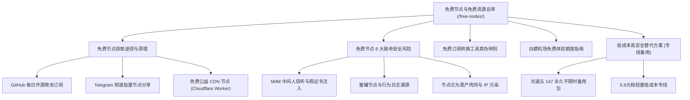

# 2026 免费节点与免费订阅深度全景指南：获取途径、风险防范与安全备用

> 知识架构：万字级支柱页（Pillar Page） ｜ 核心关键词：免费节点、免费机场、免费订阅、免费梯子、节点每日更新、免费节点安全 ｜ 更新日期：2026-11-10

“免费”是搜索引擎中月搜索量最大的关键词，也是无数科学上网新手踏入网络世界的第一站。然而，**在网络世界里，免费往往意味着最昂贵的代价**——网络黑产、中间人劫持、敏感密码窃取、频繁掉线断流等问题屡见不鲜。

本专题建立了一套**全面、真实、客观且具备极高安全实操价值的免费节点与免费订阅知识矩阵**。

<AffNotice />

---

## 🧭 免费节点专题分类与知识架构导航



---

## 一、免费节点的真实来源与底层运行机制

网络上流通的免费节点从何而来？绝非凭空产生，主要由以下四种途径构成：

| 来源类型 | 运营背景 | 带宽与延迟表现 | 真实目的与商业逻辑 | 安全评级 |
| :--- | :--- | :--- | :--- | :--- |
| **开源爬虫自动收集** | 爬取全网公开暴露的代理服务器 | 延迟极高（300ms+），可用率低于 20% | 开发者刷 Star 或吸引流量展示广告 | ⚠️ 极低（含大量蜜罐） |
| **商业机场公益引流** | 正规机场放出的少量测试节点 | 速度一般，高峰期拥堵限制在 2Mbps | 吸引用户体验并促使其升级为付费套餐 | 🟡 中等（相对可信） |
| **Cloudflare Worker 脚本自建** | 利用免费 Serverless 容器搭建 VLESS | 速度取决于当地与 CF Anycast 路由 | 极客学习与技术折腾，无技术售后 | 🟢 较高（自身可控） |
| **恶意黑客/机构钓鱼蜜罐** | 故意部署不设防的海外开放代理 | 速度通常出奇地快，不限流量 | 嗅探抓取未加密流量、记录账号密码 | 🔴 极度危险 |

---

## 二、使用免费节点必须警惕的 6 大致命安全隐患

### 1. 根证书中间人劫持（MitM Attack）
某些非法的“一键免费翻墙软件”会诱导用户在系统中安装其提供的“安全信任证书”。一旦安装，攻击者便可以在其服务器上解密您的全部 HTTPS 加密流量，导致网上银行密码、社交账号 Cookies 彻底泄露。

### 2. 账号与支付信息被盗刷
免费节点服务器的搭建者拥有全量数据包的转发控制权。如果您在连接免费节点时登录了未开启双重认证（2FA）的网站，您的明文密码很可能会被抓包存储。

### 3. 被作为违法黑产与 DDoS 攻击的“跳板肉鸡”
大量公共免费代理服务器本身是由于安全漏洞被黑客入侵控制的肉鸡。当您连入该节点时，您的网络请求可能与黑产黑客的恶意攻击流量混杂在同一 IP 地址下，导致您的个人设备在国际安全联盟中被标记为受感染终端。

### 4. 频繁断流与“假死”浪费大量时间
免费节点往往有数千人同时使用，生命周期极短（通常仅几小时至几天）。用户往往需要每天花费 1~2 小时重新寻找订阅、测试节点延迟，严重影响学习与科研生产力。

### 5. AI 工具与流媒体 100% 拦截封号
OpenAI、Anthropic 与 Netflix 维护着全网最庞大的机房 IP 黑名单数据库。免费节点的 IP 欺诈评分（Fraud Score）通常高达 90~100 分，使用免费节点访问 ChatGPT 会直接遭遇 **1020 Access Denied** 或导致昂贵的 ChatGPT Plus 账号被直接封停！

### 6. 第三方订阅转换接口“偷跑隐私”
许多新手将获取的免费节点粘贴至不知名的第三方“订阅转换网站（Subconverter）”进行格式转换。这些恶意转换站点会在后台截留您的节点配置，甚至植入后门节点。

---

## 三、白嫖机场免费试用额度的安全姿势

如果您由于紧急情况必须临时使用免费网络，**最安全、可靠的方式不是使用公开的免费节点，而是利用商业机场提供的正规试用额度**：

1. **注册即送体验流量的正规机场**：
   - 商业机场为了拉新，通常会在注册后提供 1~3 天或 1~5GB 的免费体验流量。
   - 这类节点走的是正规机房中转甚至专线链路，**不注入恶意证书，也不偷窥隐私**。
2. **安全隔离原则**：
   - 使用临时邮箱注册，**绝不要使用与日常核心账号相同的密码**。
   - 体验期间切勿进行银行转账、涉及大额资金支付或企业内部机密传输。

---

## 四、为什么“不限时按量套餐”才是免费用户的终极归宿？

很多用户执着于“免费节点”，本质上并不是买不起几十元的套餐，而是**“使用频次极低”**——一个月可能只想用一次 Google 查篇资料，或者临时查封邮件，觉得按月续费 20~30 元很浪费。

针对这一痛点，本站网络实验室推荐**用低廉的买断制一次性按量套餐，替代危险的免费节点**：

<div class="kyoto-card">
  <h4 style="color: var(--vp-c-brand-3); margin-top: 0;">💡 算一笔明白账：免费节点 vs 买断不限时套餐</h4>
  <ul>
    <li><strong>方案 A（每天折腾免费节点）</strong>：每月花费 30 小时寻找失效订阅、承受密码泄露风险、关键时刻断连，实际成本隐性巨大。</li>
    <li><strong>方案 B（[光速云](/reviews/guangsu) 致敬斯诺克 147 永久套餐）</strong>：一次性支付 ¥147，享有 <strong>247GB 永久不过期高速专线流量</strong>。如果每月查资料仅消耗 2GB，可以使用超过 <strong>10 年</strong>！平均每月仅花费 1.2 元，享受到的是单节点 500Mbps+ 的纯净 IEPL 物理专线与 ChatGPT 原生解锁！</li>
    <li><strong>方案 C（[微风网络](/reviews/weifeng) 信风不限时包）</strong>：¥200 享 270GB 永久有效专线流量，优惠码 <code>flat888</code>。</li>
    <li><strong>方案 D（[大佬云](/reviews/dalaoyun) 5.6元轻量档）</strong>：每月仅需 5.6 元，比买一瓶饮料还便宜，拥有稳定自研 App 与售后支持。</li>
  </ul>
</div>

---

## ❓ 免费节点高频问题解答 (FAQ)

### Q1：GitHub 上高 Star 的每日免费节点仓库能用吗？
**答**：可以使用，但仅建议用于临时应急或测试网络环境。切记在客户端中开启白名单规则，绝不要在开启该节点时登录邮箱、微信或银行客户端。

### Q2：使用免费节点会泄露微信/支付宝密码吗？
**答**：正规的银行与国民级 App（如微信、支付宝）在底层均部署了强制 SSL Pinning（证书锁定技术），即使节点中间人试图拦截，App 也会直接拒绝握手断开连接。但对于一般的网页登录、海外论坛或未开启双重认证的账户，存在明确的密码嗅探泄露风险。

### Q3：为什么免费节点测速能达到 100Mbps，但网页就是打不开？
**答**：测速工具通常只测试与测速服务器之间的 TCP 瞬时吞吐；而真实网页访问依赖极高精度的 DNS 解析与频繁的 TLS 握手。免费节点往往在 DNS 上存在严重劫持，或者出口机房被封锁，导致 TCP 连接成功但无法完成 HTTP 握手。

---

## 🎯 结论与安全使用准则

1. **零资金投入时**：仅在应急或学术查阅时选用知名开源社区的公开节点，严禁进行任何敏感账号登录；
2. **重视效率与数据安全时**：果断选用具备正规专线背书的低价方案（如 [光速云](/reviews/guangsu)、[飞猫云](/reviews/feimao)），将精力集中于业务与学习本身。

```html
<script type="application/ld+json">
{
  "@context": "https://schema.org",
  "@type": "TechArticle",
  "headline": "2026 免费节点与免费订阅深度全景指南：获取途径、风险防范与安全备用",
  "datePublished": "2026-08-11T12:00:00+08:00",
  "dateModified": "2026-11-10T17:30:00+08:00",
  "author": {
    "@type": "Organization",
    "name": "TAG 博客网络实验室",
    "url": "https://tagblog.world/about/"
  },
  "publisher": {
    "@type": "Organization",
    "name": "TAG 博客",
    "url": "https://tagblog.world/"
  }
}
</script>
```
