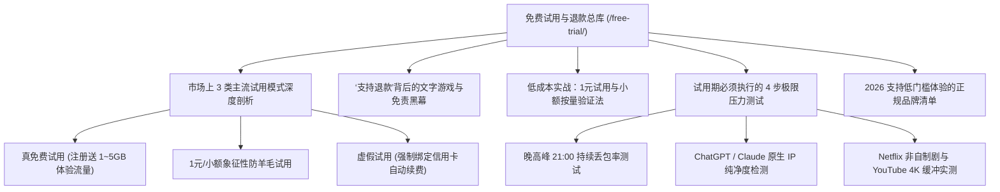

# 2026 机场免费试用与退款避坑全景指南：真假试用盘点与低成本验证方案

> 知识架构：万字级支柱页（Pillar Page） ｜ 核心关键词：免费试用机场、1元试用机场、机场退款政策、机场免费体验、科学上网低成本验证 ｜ 更新日期：2026-11-10

许多消费者在初次挑选机场时，最渴望的就是**“先试用、满意后再付款”**。然而，由于黑产与羊毛党恶意滥用，市面上真正提供“无门槛免费试用”的服务商越来越少；与此同时，部分黑心商家借着“免费体验”的幌子诱导用户预授权扣款，甚至在购买后以各种理由拒绝退款。

本专题为您提供**最详实、最透明的 2026 机场免费试用全景分析与无痛低成本验证策略**。

<AffNotice />

---

## 🧭 免费试用与退款政策知识导航



---

## 一、真试用 vs 假试用：识别 3 大常见体验套路

| 试用类型 | 运作方式 | 优点 | 潜在陷阱与注意事项 |
| :--- | :--- | :--- | :--- |
| **正规免费试用** | 注册账号后直接获赠 1~3 天或 1~5GB 流量 | 0 成本、无需任何支付绑定 | 试用节点通常较少，晚高峰可能有限速 |
| **1元象征性防刷试用** | 支付 1 元购买临时体验包（如 24 小时 20GB） | 享受完整专线节点与全量带宽 | 必须确认是否开启了“到期自动按月续订” |
| **虚假流氓试用** | 宣称“首月免费”，但必须绑定信用卡 | 表面无成本 | 隐藏自动扣款协议，次月以数十倍原价强行扣费 |

---

## 二、退款政策黑幕：为什么“7天无理由”几乎不存在？

在选购科学上网服务前，请务必认清一个行业共识：**95% 以上的正规机场均明确声明“虚拟技术服务，一经售出，概不退款”**。

### 为什么商家不支持无理由退款？
1. **防止羊毛党反复薅退款**：某些用户为了短期大文件下载，充值后下载几百 GB 随即申请全额退款；
2. **上游机房账单不可退**：机场主向上游 IDC 租赁的 IEPL 物理专线与出口服务器都是按月/按季度预付费的，机房不会因个别用户退订而退款。

### 应对之策：
**永远不要寄希望于“买完觉得不好用再退款”！** 最佳的做法是：
- 优先选择有 **1 元试用包** 或 **起步门槛极低（如 5~8 元/月）** 的品牌；
- 先买 1 个月，如果晚高峰测试满意，下个月再决定是否升级。

---

## 三、试用期 4 步极限压力测试法（如何 30 分钟验出真假专线）

当您获取了一个机场的测试资格或小额月付套餐后，不要只是简单打开百度或随便刷个网页，**必须在晚高峰执行以下 4 步排查**：

### 步骤 1：晚高峰 21:00 丢包率与延迟抖动测试
- 在客户端中打开延迟测速面板，连续测试 10 次；
- 若香港节点延迟持续维持在 **20~40ms** 且 0 次超时，说明专线质量扎实；若延迟出现 100ms 与 500ms 剧烈跳跃，说明是廉价拥堵中转。

### 步骤 2：ChatGPT 与 Claude 网页端实录
- 登录 `chatgpt.com`，发起一次长文本生成与 Python 代码分析；
- 观察是否频繁触发 Cloudflare 验证码或弹出 Access Denied 报错。

### 步骤 3：YouTube 4K 详细统计信息监测
- 搜索播放一条 4K 60fps HDR 超高清视频；
- 在画面右键开启“详细统计信息”，观察 `Connection Speed` 是否稳定突破 **50,000 Kbps**，`Buffer Health` 缓冲区健康度是否稳定大于 30 秒。

### 步骤 4：客户端分流规则与多端兼容测试
- 在开启代理的状态下访问国内网站（如 `bilibili.com`、`baidu.com`），确认分流规则是否能够自动直连，避免白白消耗宝贵的代理流量。

---

## 🏆 2026 低门槛验证与高性价比推荐清单

如果某家机场不提供免费试用，但其入门门槛极低，同样属于**“极低试错成本”**的优秀代表：

| 品牌 | 体验门槛 | 线路类型 | 专属优惠码 | 核心优势 |
| :--- | :--- | :--- | :--- | :--- |
| **[飞猫云](/reviews/feimao)** | **约 7 元/月 (学生版)** | 专线直连 | `flycat888` | 自研客户端免配置，下载登录即用，新手试错首选 |
| **[光速云](/reviews/guangsu)** | **8 元/月起 / 147永久套餐** | IEPL专线+内网专线 | `AMM` | 2020老牌，实测 529Mbps，致敬斯诺克永久不过期 |
| **[微风网络](/reviews/weifeng)** | **约 7 元/月起 (清风版)** | IEPL专线原生IP | `flat888` | 香港节点 546Mbps 峰值，原生 IP 解锁良好 |
| **[大佬云](/reviews/dalaoyun)** | **约 5.6 元/月 (年付档)** | IEPL专线 | `dly888` | 业内极低专线门槛，适合学生党日常备用 |

---

## ❓ 试用与退款高频问题解答 (FAQ)

### Q1：为什么很多机场现在取消了“免费试用”？
**答**：近年来网络审查加剧，黑灰产利用自动化脚本大量注册免费试用账号用于发送垃圾邮件或非法爬虫，导致免费测试节点的 IP 在几小时内被各大安全联盟全部拉黑，正规用户根本无法正常使用。因此，严肃的服务商普遍转向“1 元象征性扣费试用”或“极低入门月付档”。

### Q2：使用信用卡进行海外机场试用安全吗？
**答**：建议优先使用国内支持的 **支付宝、微信或 USDT** 进行一次性充值。若必须绑定海外信用卡，请尽量使用支持设置单次交易额度或随时销卡的“虚拟信用卡”，防止到期后被商家自动发起高额月租扣款。

---

## 🎯 总结建议

将“寻找免费试用”的精力，转化为**“使用 1 杯饮料钱购买正规月付进行科学实测”**，是 2026 年最明智、最高效的科学上网决策路径。

```html
<script type="application/ld+json">
{
  "@context": "https://schema.org",
  "@type": "Article",
  "headline": "2026 机场免费试用与退款避坑全景指南：真假试用盘点与低成本验证方案",
  "datePublished": "2026-08-11T12:00:00+08:00",
  "dateModified": "2026-11-10T17:30:00+08:00",
  "author": {
    "@type": "Organization",
    "name": "TAG 博客网络实验室",
    "url": "https://tagblog.world/about/"
  },
  "publisher": {
    "@type": "Organization",
    "name": "TAG 博客",
    "url": "https://tagblog.world/"
  }
}
</script>
```
