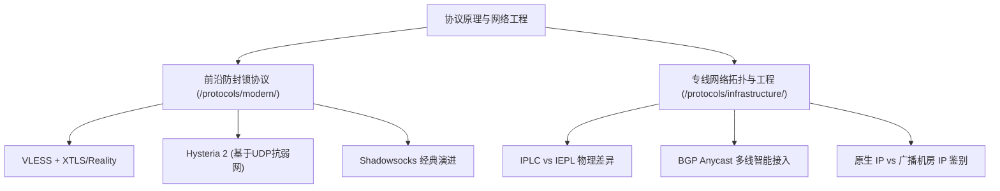

# 协议原理与网络工程：从 VLESS/Reality 到 IPLC 物理专线架构全解析

> 知识架构：支柱页（Pillar Page） ｜ 覆盖关键词：VLESS协议、IPLC区别、IEPL专线、Hysteria2原理 ｜ 更新日期：2026-11-10

很多用户在选购机场时经常看到 **VLESS、Shadowsocks、IPLC、IEPL、BGP** 等专业名词，却难以理解它们对实际速度与稳定性的影响。

本专题从网络通信与密码工程角度，为您拆解代理工具底层的真实运转逻辑。

<AffNotice />

---

## ⚡ 核心二级专题入口

- 👉 **[进入专题：前沿防封锁协议（VLESS / Reality / Hysteria 2 / sing-box）](/protocols/modern/)**  
  *深入探索 TLS 握手特征对抗、伪装网站技术、基于 UDP 的抗丢包黑科技。*
- 👉 **[进入专题：专线网络拓扑与工程（IPLC / IEPL / BGP智能调度）](/protocols/infrastructure/)**  
  *深入探索内网点对点光纤、三网入口智能分流、TCP BBR 拥塞控制与原生住宅 IP 原理。*
