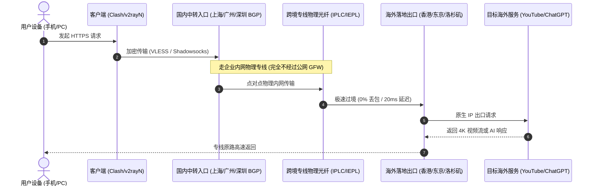

# 专线网络拓扑与工程：IPLC/IEPL 物理差异、三网 BGP 与原生 IP 解读

> 所属专题：协议原理与网络工程 ｜ 二级专题定位：底层基础设施与专线拓扑 ｜ 数据核实：2026-11-10

优秀的科学上网服务商，其核心壁垒从来不是技术协议本身，而是**昂贵的物理网络资产与骨干网互联带宽**。

<AffNotice />

---

## 🗺️ 专线网络数据流向拓扑

---

## ⚡ 10 大三级长尾知识集群规划

### 集群 1：IPLC 与 IEPL 物理专线真正差异
- **IPLC（国际私有租用线路）**：传统的点对点物理光缆，价格最高昂，带宽独享。
- **IEPL（国际以太网私有线路）**：基于现代以太网封装，具备更强的抖动控制与动态带宽调度能力。二者均不经过公网防火墙，晚高峰稳定性在同一梯队。

### 集群 2：BGP Anycast 与智能多线接入
- 单一机房经常因某地光纤施工发生波动，BGP 智能动态路由可让全国用户就近接入最近的低延迟入口。

### 集群 3：跨境网络晚高峰 QoS 优先级机制
- 深入解析中国电信 163 骨干网 vs CN2 GIA、中国联通 169 vs 联通 AS9929 的优先级等级。

### 集群 4：TCP BBR / BBRv3 拥塞控制算法
- 现代中转服务器如何通过激进的带宽探测算法，在轻微丢包的网络中榨取更高的有效下载吞吐。

### 集群 5：原生 IP（Native IP）vs 广播机房 IP 辨析
- 为什么有的香港 IP 能够看 Netflix，有的却只能看自制剧？通过 IPinfo / MaxMind 数据库解析广播机房与本地住宅的区别。

### 集群 6：双 ISP 属性对海外养号的商业价值
- 跨境电商独立站（Shopify/Amazon）与 PayPal 支付中，原生住宅双 ISP 节点的防封号逻辑。

### 集群 7：DNS 泄露与 ECS（EDNS Client Subnet）防污染
- 防止本地 DNS 请求被运营商劫持并暴露访问行为的最佳实践。

### 集群 8：CDN 反代与多中转链路拓扑
- 分析 Cloudflare 等 CDN 在代理网络中的加速与减速效应。

### 集群 9：MTU / MSS 最佳数据包长度调优
- 解决软路由代理下特定网银或游戏频繁报错“数据包超时”的底层 MTU 分片配置。

### 集群 10：企业内网跨境专线的合规性与边界
- 个人梯子与企业正规申请的工信部备案国际专线的法律边界与技术界定。
