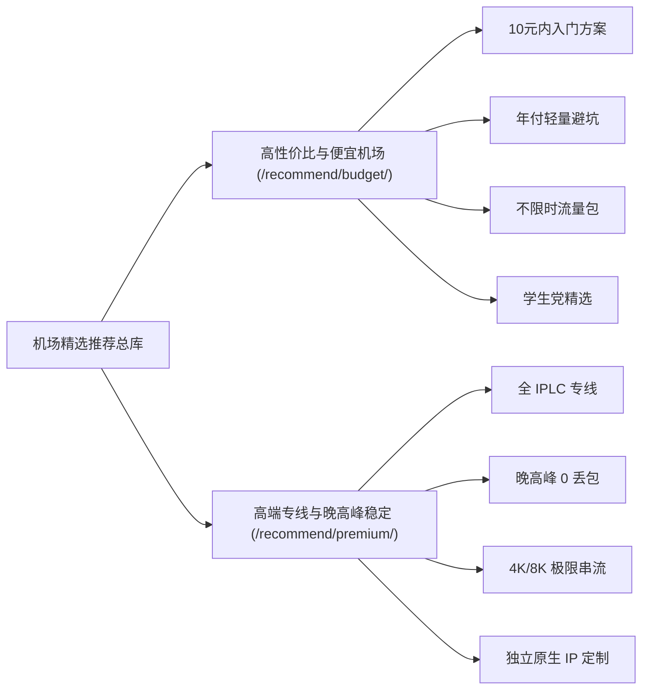

# 2026 稳定机场推荐全景指南：价格、线路、晚高峰与选型知识图谱

> 知识架构：支柱页（Pillar Page） ｜ 覆盖关键词：2026机场推荐、稳定机场、便宜机场、专线机场怎么选 ｜ 更新日期：2026-11-10

购买机场（梯子/网络代理）不是买得越贵越好，也不是节点数量越多越好。市面上存在大量打着“全专线”旗号的廉价中转超售平台，也有动辄数十元却在晚高峰频繁断流的服务。

本指南旨在为您建立一套**系统化、可度量的科学上网选型决策图谱**。

<AffNotice />

---

## 🧭 选型两大核心支柱入口

为避免关键词相互竞争并精准匹配您的使用场景，我们将精选推荐体系拆分为两大二级专题：

- 👉 **[进入专题：高性价比与便宜机场（10元档/学生党/备用包）](/recommend/budget/)**  
  *深入探讨每GB单价换算、月付止损策略、轻度网页检索与低成本专线方案。*
- 👉 **[进入专题：高端专线与晚高峰稳定机场（IPLC/IEPL/企业办公）](/recommend/premium/)**  
  *深入探讨物理点对点专线、三网BGP负载均衡、晚高峰20:00~23:00真实丢包率对抗与流媒体全解锁。*

---

## 📐 机场选型八维客观决策模型

在 TAG 博客实验室，任何一家被推荐的机场都必须通过以下 8 项维度的严格评估：

1. **线路物理性质（Line Infrastructure）**：
   - *公网直连（Direct）*：价格极低，但极易被封锁，晚高峰丢包通常高于 30%，不作主力推荐。
   - *国内中转（Relay）*：通过国内服务器转发，降低直连被墙风险，但晚高峰易受入口带宽挤压。
   - *IEPL / IPLC 专线（Private Line）*：不经过公网 GFW，两端通过内网直接打通，晚高峰稳定性第一。
2. **协议抗审查能力（Protocol Robustness）**：
   - 现代代理已全面迈入 **VLESS (Reality / XTLS)** 与 **Hysteria 2 / TUIC** 时代。经典 Shadowsocks 适合在内网专线中发挥低开销优势。
3. **真实带宽冗余（True Bandwidth Headroom）**：
   - 警惕“千兆跑满”宣传，核心看单节点单线程在晚高峰 21:00 能否稳定维持在 50Mbps 以上（满足 4K 播放基本门槛）。
4. **原生 IP 纯净度（IP Quality & Fraud Score）**：
   - 是否为机房广播 IP 还是原生住宅 IP，直接决定了 Netflix 是否能看非自制剧，以及 ChatGPT 是否频繁弹出人机验证码。
5. **付费周期弹性（Billing Flexibility）**：
   - 必须提供月付或小额季度套餐。凡是只支持年付甚至两年付的低价小机场，跑路风险增加 80%。
6. **客户端兼容与分流生态（Ecosystem Compatibility）**：
   - 是否支持 Clash Verge Rev、v2rayN、Shadowrocket 等标准订阅格式，分流规则更新是否及时。
7. **客服与运维响应（SLA & Support）**：
   - 节点失效时是否有工单或真人值守，修复时间是否在 24 小时以内。
8. **运营年限与口碑留存（Longevity）**：
   - 优先选择运营 3 年以上的成熟服务商（如 [光速云](/reviews/guangsu) 2020 年至今），新开机场务必保持月付。
