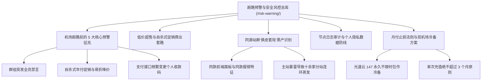

# 2026 机场跑路预警与安全风控深度全景指南：识别前兆、防超售与隐私防御

> 知识架构：万字级支柱页（Pillar Page） ｜ 核心关键词：机场跑路、梯子跑路预警、同源站群、低价超售、机场隐私安全、防跑路技巧 ｜ 更新日期：2026-11-10

在网络代理（机场）这个高度去中心化、缺乏传统工商监管的行业中，**“跑路”是每一个消费者都必须严肃面对的系统性风险**。每年有数百家小作坊机场因上游机房封禁、资金链断裂、恶性竞争或蓄意圈钱而瞬间关站失联。

本专题建立了一套**数据化、可量化的风险预警体系与安全防御盾牌**，帮助您彻底远离“交了年费、用了三天、人去楼空”的消费陷阱。

<AffNotice />

---

## 🧭 跑路预警与安全风控专题架构导航



---

## 一、机场跑路前的 5 大经典技术特征（警报红线）

根据 TAG 博客网络实验室持续数年的追踪监测，绝大多数机场在正式关站跑路前 7~30 天，都会表现出极其相似的**异常异动信号**：

| 异常异动征兆 | 风险等级 | 底层原因分析 | 应急自救措施 |
| :--- | :---: | :--- | :--- |
| **官方 TG 群开启“全员永久禁言”** | 🔴 极高 (90% 必跑) | 节点大面积故障，店主为了防止用户维权骚扰或争取最后提现时间 | **立即停止续费**，导出常用海外配置 |
| **突发“永久买断 / 5折年付大促销”** | 🔴 极高 (85% 圈钱) | 现金流断裂，用不可持续的虚高流量做最后一波收割套现 | **切勿贪小便宜**，坚决不参与长周期充值 |
| **工单系统彻底失联超过 72 小时** | 🟡 高度危险 | 运营者已无心维护，或技术人员已经流失 | 视为已停服，准备切换备用机场 |
| **核心专线节点持续全红，仅剩廉价直连** | 🟡 高度危险 | 拖欠上游 IDC 机房租金，物理专线已被机房拔线停机 | 节点已发生严重降级，不再具备使用价值 |
| **支付网关频繁跳转至不安全的个人二维码** | 🟠 中度风险 | 原有正规第三方聚合支付渠道因洗钱/投诉被银行风控清退 | 警惕支付欺诈风险 |

---

## 二、低价超售与“数学诈骗”模型拆解

许多初涉科学上网的用户常被“1 元 1000GB”、“9.9 元一年无限流量”等宣传吸引。在计算机物理工程中，**这在数学和商业上是绝对不可能成立的**：

### 真实物理成本测算
1. **真实专线带宽成本**：一条正规的 1Gbps 跨境 IEPL 专线，IDC 商业租金每月在 **数万元人民币** 以上；
2. **流量单价底线**：即使采用最极端的网络压缩，专线每 1GB 流量的纯物理过境成本也不会低于 **0.015~0.03 元**；
3. **超售崩盘过程**：
   - 某低价机场以 10 元/年的价格销售给 10,000 名用户，收取 10 万元资金；
   - 这 10,000 名用户只要有 10% 在晚高峰看 4K 视频，瞬时带宽需求就将突破 **50Gbps**，其月度机房账单将高达数十万元；
   - 收入（10万）与支出（几十万）形成倒挂，商家唯一的结局只有两个：**要么将网速限制在几十 Kbps 让所有人卡死，要么直接卷走这 10 万元关站跑路**。

---

## 三、警惕同源站群“换皮套现”连环雷

在科学上网圈，存在大量**“一人开十站、换皮收割”**的同源站群现象：

- **典型特征**：
  - 域名看似各不相同，但网站底部的“服务条款”甚至保留了相同的错别字；
  - 节点命名规则、套餐价格梯度（如均有“VIP1~VIP4”）、支付商户名称高度雷同；
- **危害**：
  - 这类站群通常共用同一套底层服务器入口。当商家资金链断裂时，并不会只关闭一个站点，而是**十几个品牌在同一夜之间集体蒸发**！
- **鉴别防范**：
  - 在选择机场时，优先选择拥有**独立长寿品牌背书、公开技术路线、且具备自研客户端开发能力**的老牌独立团队（如 [光速云](/reviews/guangsu)、[飞猫云](/reviews/feimao)）。

---

## 四、节点日志审计与个人数据防线

机场不仅涉及资金安全，更涉及**通信隐私安全**：

1. **中间人抓包与审计风险**：
   - 不良服务商可能会在出口落地服务器上运行日志审计程序，记录用户访问的域名明细；
   - **防范准则**：在连接机场节点时，**确保所有访问均为标准 HTTPS 加密**。永远不要信任任何要求您在手机或电脑中“安装未知根证书”的第三方代理工具。
2. **订阅链接（Token）防盗刷**：
   - 订阅链接（Sub Link）等同于您的提货凭证。切勿将订阅链接公开发布在社交媒体、GitHub 仓库或不知名的第三方在线转换工具中；
   - 一旦发现流量异常消耗，应立即在机场后台点击 **“重置订阅信息（Reset Token）”**。

---

## 五、科学上网防跑路最高黄金法则：双机场冷备与月付止损

要想彻底摆脱被跑路牵制的被动局面，只需严格执行以下两项原则：

### 原则一：坚持“单次续费绝不超过 3 个月”
对于任何新开业不足两年的机场，无论宣传多么天花乱坠、无论折扣多么诱人，**坚决按月付费**。即使遇到突发跑路，损失也仅限于十几元的一杯奶茶钱。

### 原则二：建立“主力专线 ＋ 买断永久包”双活容灾体系
- **主力通道（日常高速）**：购买月付的高质量 IEPL 专线（如 [微风网络](/reviews/weifeng) 或 [暮光加速](/reviews/muguang)）；
- **冷备钥匙（防断连兜底）**：购买一份不限时、不过期的永久流量包（首推 [光速云](/reviews/guangsu) 的致敬斯诺克 147 永久套餐，¥147 享 247GB 永久不过期高速流量）。
- **容灾收益**：即便主力机场某天遭遇突发割接或跑路，只需在客户端中点击切换到光速云的永久节点，**0 秒恢复国际互联网连通**，彻底告别失联焦虑！

---

## ❓ 跑路预警高频问题解答 (FAQ)

### Q1：运营时间超过 5 年的老牌机场，就一定 100% 不会跑路吗？
**答**：没有绝对的“100% 不跑路”。老牌机场的优势在于其商业模式早已跑通、拥有稳定的老用户月付续费现金流，且积累了成熟的上游机房合作关系，其主动恶意卷款跑路的概率远低于新机场。但依然建议用户保持月付或季度付费习惯，规避不可抗力风险。

### Q2：机场突然打不开了，怎么判断是“节点维护”还是“彻底跑路”？
**答**：首先查看其官方 Telegram 频道或官网公告；如果仅仅是部分节点超时而官方仍在发布维护通告，通常是线路维护；如果官网域名无法解析、官方群组全员禁言且超过 48 小时无任何声音，基本可以确认停服。

---

## 🎯 结论

防跑路的核心不在于寻找“承诺永远不跑”的神仙商家，而在于**建立科学的自我防护机制——用月付控制资金风险，用不限时专线构筑冷备防线**。

```html
<script type="application/ld+json">
{
  "@context": "https://schema.org",
  "@type": "Article",
  "headline": "2026 机场跑路预警与安全风控深度全景指南：识别前兆、防超售与隐私防御",
  "datePublished": "2026-08-11T12:00:00+08:00",
  "dateModified": "2026-11-10T17:30:00+08:00",
  "author": {
    "@type": "Organization",
    "name": "TAG 博客网络实验室",
    "url": "https://tagblog.world/about/"
  },
  "publisher": {
    "@type": "Organization",
    "name": "TAG 博客",
    "url": "https://tagblog.world/"
  }
}
</script>
```
