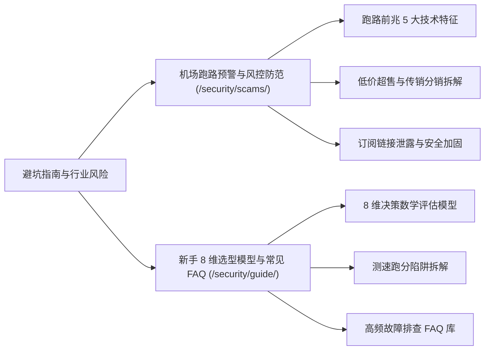

# 避坑指南与行业风险透视：跑路预警、隐私安全与选型防坑全景

> 知识架构：支柱页（Pillar Page） ｜ 覆盖关键词：机场跑路、梯子被骗、隐私安全、机场选购避坑 ｜ 更新日期：2026-11-10

网络代理服务处于法律与技术的交叉地带，缺乏正规的消费者权益保护机制。每年都有上百家小机场由于**资金链断裂、DDOS 恶意竞争、机房通报查封或店主恶意套现**而在一夜之间失联。

本专题为您撕开行业灰产内幕，提供坚不可摧的安全防御盾牌。

<AffNotice />

---

## 🛡️ 核心二级专题入口

- 👉 **[进入专题：机场跑路预警与风控防范（跑路前兆 / 隐私泄露 / 容灾冷备）](/security/scams/)**  
  *深入剖析停服前兆、支付渠道异常、同源站群换皮与订阅保护。*
- 👉 **[进入专题：新手 8 维选型模型与常见 FAQ（决策树 / 测速陷阱 / 问答库）](/security/guide/)**  
  *建立科学的选型决策树，彻底解答为什么机场测速快实际用却卡等根本问题。*
